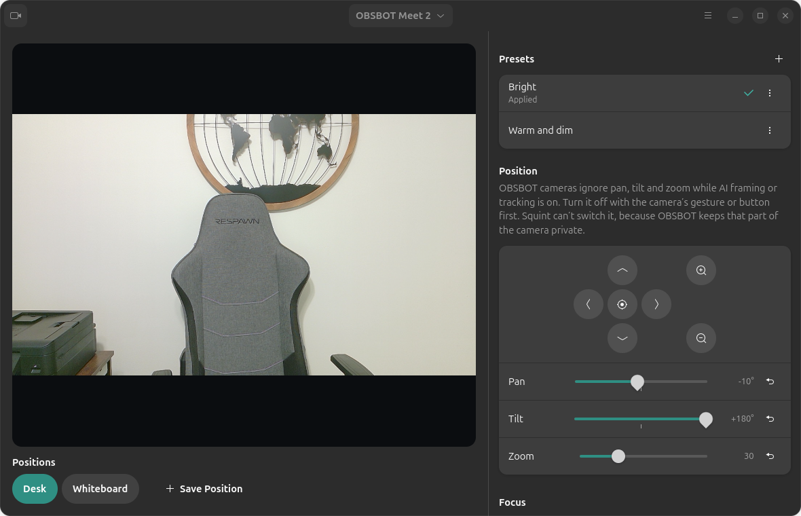
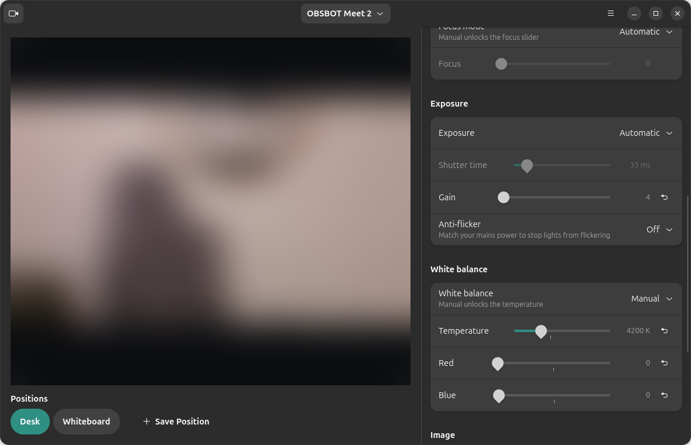
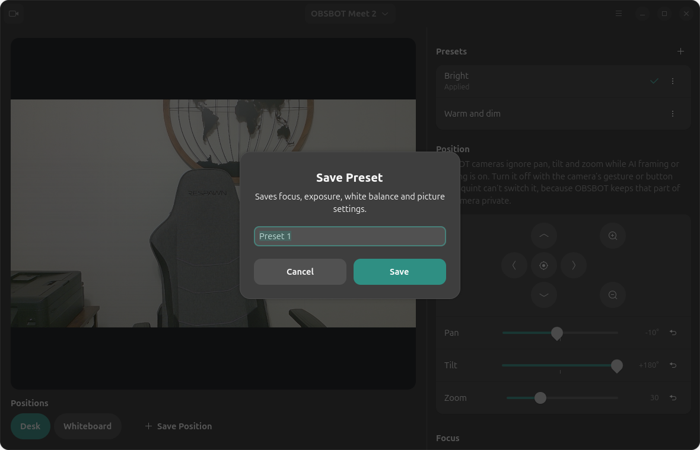
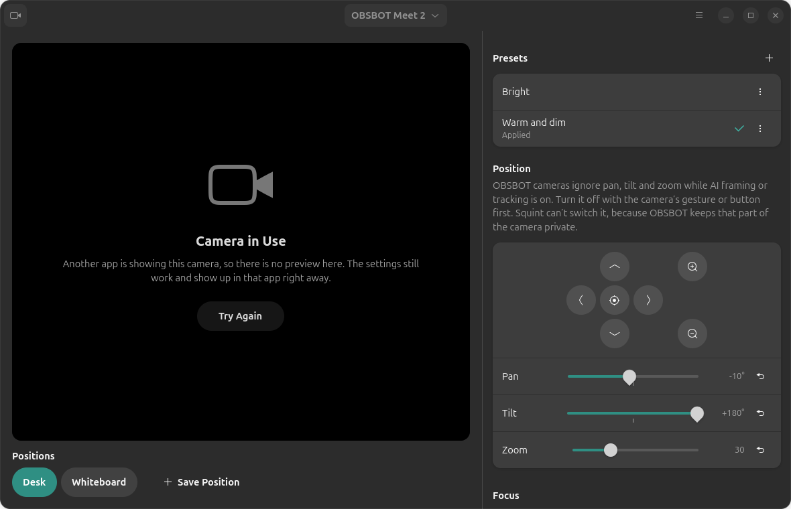

# Hawk

*Formerly Squint. Part of the Sedge family of webhookstudios apps.*

A webcam control panel for Ubuntu, in the spirit of OBSBOT Center or Logitech G HUB. Hawk shows a live preview of your camera next to every setting it supports, and saves presets you can recall with one click. Built with GTK 4 and libadwaita, so it fits Ubuntu.



## What it does

- **Live preview** of the selected camera, with a camera picker when more than one is plugged in. Scroll on the preview to zoom.
- **Position:** an arrow pad (hold an arrow to keep moving) plus pan, tilt and zoom sliders. The center button points the camera straight ahead again.
- **Focus** and **white balance:** choose **Automatic** or **Manual**. Manual unlocks the focus slider or the color temperature (and red/blue balance on cameras that have them).
- **Exposure:** automatic, manual or priority modes, plus shutter time and gain.
- **Image:** brightness, contrast, saturation, hue, sharpness, gamma and backlight compensation.
- **Anti-flicker:** 50 Hz, 60 Hz or off, to match your mains power.
- **Only what your camera has:** Hawk asks the camera which controls it supports and shows only those. Anything it doesn't recognize appears under **Other**. Controls locked by an automatic mode are greyed out.
- **Presets:** save the current picture settings under a name, then click one to put it back. The check mark shows the last one you used, and it says **Applied, with changes** once you change something.
- **Positions:** save where the camera points and its zoom as buttons under the preview (**Desk**, **Whiteboard**…). One click goes there. Right-click a button to update, rename or delete it.
- **Keeps your settings after you close it:** whatever you set in Hawk becomes the camera's default. Hawk stays running quietly in the background (and starts at login), and puts your settings back:
  - when the camera is plugged in, since many webcams forget their settings when unplugged;
  - at login and when you open Hawk;
  - **when another app opens the camera.** Some apps (browsers, Zoom, Teams) reset the camera when they start. A couple of seconds after any app opens the camera, Hawk checks and puts back anything that changed. Changes you make inside that app afterwards are left alone.

  Turn this off with **Keep My Settings After Closing** in the main menu. <kbd>Ctrl</kbd>+<kbd>Q</kbd> quits Hawk completely until the next login.
- **Works alongside other apps:** while Zoom, Meet or OBS is using the camera, the preview pauses but every setting still works, and the change shows up in that app right away.
- Presets are kept per camera, so two different webcams each have their own.







## Cameras

Hawk works with any USB webcam that follows the UVC standard, which is nearly all of them. It asks each camera what it supports, so every model gets the controls it really has:

| Camera | What to expect |
|---|---|
| **Logitech** (C270, C920, C922, StreamCam, Brio and others) | Focus, exposure, white balance, picture settings and anti-flicker. Zoom and pan/tilt on models that report them (C920/C922/Brio, as a digital crop). On the Brio, the infrared face-login camera is skipped automatically. |
| **Logitech PTZ** (PTZ Pro 2, Rally) and other conference PTZ cameras | Pan and tilt by speed or by position, whichever the camera offers, plus zoom. Hold an arrow to move, let go to stop. |
| **Razer Kiyo, Kiyo X, Kiyo Pro** | Focus, exposure, white balance, picture settings; zoom on models that have it. The Kiyo's ring light is a dial on the camera, not a USB setting, so Hawk can't change it. |
| **OBSBOT Meet 2, Meet, Tiny, Tiny 2, Tail** | All standard controls, including the gimbal's pan/tilt on the Tiny models. AI modes: see below. |
| **OBSBOT Meet 4K** | The same, plus an **AI tracking: Fixed / Track me** switch. |
| **Anything else** | Every standard control the camera reports. Ones Hawk has no name for appear under **Other**. |

Only the OBSBOT Meet 2 has been tested on a real camera. The others are supported through the same standard controls, and through the speed-style pan and tilt that PTZ cameras use, which was checked by driving the Meet 2 that way.

Camera features that live only in a brand's own app aren't available: Logitech's RightLight, Razer's Synapse effects, and OBSBOT's AI modes on most models.

## OBSBOT cameras

Tested with an **OBSBOT Meet 2**. Over the standard UVC controls it reports brightness, contrast, saturation, hue, sharpness, gain, backlight compensation, anti-flicker, auto/manual exposure and shutter time, auto/manual white balance and temperature, auto/manual focus, and pan, tilt and zoom. Hawk controls all of these.

What Hawk **can't** do on OBSBOT cameras:

- **AI tracking on/off, auto-framing modes, face focus, gesture control and HDR on the Meet 2, Tiny, Tiny 2 and Tail.** OBSBOT Center switches these through a private "extension unit" on the camera (on the Meet 2, unit 2 with GUID `9a1e7291-6843-4683-6d92-39bc7906ee49`, seven 60-byte commands). OBSBOT doesn't publish what those bytes mean, and Hawk doesn't guess. Sending made-up commands to a camera's firmware is how you break one.
- **Pan, tilt and zoom while AI framing is on.** The Meet 2 accepts the values but its AI framing keeps control of the picture, so nothing visibly moves. Turn AI framing off first with the camera's gesture or button (or once in OBSBOT Center on another computer; the camera remembers it). Hawk shows this note under **Position** for OBSBOT cameras.

**Meet 4K only:** the AI tracking switch (**Fixed** / **Track me**) uses the commands published by the open-source [meet4k](https://github.com/samliddicott/meet4k) tool, which was written on that camera (unit 6, selector 6). Hawk only sends them after checking that the camera calls itself a Meet 4K and has that exact unit. It hasn't been tested on a real Meet 4K. Your choice is kept and put back along with your other settings. The Meet 2's unit is laid out differently, so these commands are not sent to it.

OBSBOT's official [SDK](https://obsbot.com/sdk) lists Linux and the Meet 2. If you download it, AI modes and face focus could be added through it.

## Requirements

- Ubuntu 24.04 or newer, or another GNOME desktop with libadwaita 1.5+
- A USB webcam (UVC, which is nearly all of them)
- GStreamer with the GTK 4 plugin for the preview (`gstreamer1.0-gtk4`). The deb package installs it for you. Without it the settings still work, with no preview.

No `v4l2-ctl` or other tools needed: Hawk talks to the camera directly.

## Install

### With the deb package (recommended)

Download `hawk_1.1.0_all.deb` from the [latest release](https://github.com/webhookstudios/hawk/releases/latest), then:

```bash
sudo apt install ./hawk_1.1.0_all.deb
```

Open **Hawk** from the apps menu. The package also adds a login item that puts your last preset back. To remove it:

```bash
sudo apt remove hawk
```

### From source, for the current user only

```bash
git clone https://github.com/webhookstudios/hawk.git
```

```bash
sudo apt install python3-gi gir1.2-adw-1 gir1.2-gst-plugins-base-1.0 gstreamer1.0-plugins-good gstreamer1.0-gtk4
```

```bash
./hawk/install.sh
```

This installs to `~/.local/share/hawk`, adds `hawk` to `~/.local/bin`, and adds the same login item. Remove it with `./install.sh --uninstall`.

## Using it

1. Open Hawk. Your camera is picked and the preview starts.
2. Set the picture up the way you like, then click **+** next to **Presets** (or press <kbd>Ctrl</kbd>+<kbd>S</kbd>) and give it a name.
3. Point and zoom the camera, then click **Save Position** under the preview.
4. Click any preset or position to go back to it.

<kbd>Ctrl</kbd>+<kbd>P</kbd> turns the preview on and off. Turn it off if another app can't open the camera while Hawk is showing it.

## Command line and shortcuts

```
hawk --list                  # cameras, and their saved presets and positions
hawk --apply "Desk"          # apply a preset or position by name
hawk --apply "Bright" --camera "Meet"   # pick a camera by name or /dev/video path
```

For a keyboard shortcut, go to Settings → Keyboard → View and Customize Shortcuts → Custom Shortcuts and add one with the command `hawk --apply "Whiteboard"`.

## Where things are kept

| What | Where |
|---|---|
| Presets, positions and settings | `~/.config/hawk/settings.json` |
| Login item | `~/.config/autostart/` (source install) or `/etc/xdg/autostart/` (deb) |
| How you left each camera | The same settings file, under `current` |

Presets are stored per camera, by its USB vendor and product id and serial number when it has one. Nothing is sent anywhere.

## How it works

- Controls are read and written with the standard V4L2 ioctls (`VIDIOC_QUERY_EXT_CTRL`, `VIDIOC_G_CTRL`, `VIDIOC_S_CTRL`) on `/dev/video*`, the same controls `v4l2-ctl --list-ctrls-menus` shows. Hawk never writes to vendor extension units.
- When a preset is applied, automatic modes are set first, so the manual values they unlock are accepted.
- Every change you make in Hawk is saved as how you left that camera. Hawk watches each `/dev/video*` node with inotify. Opening a device raises an event, whichever app opens it, so Hawk knows when Zoom or a browser starts the camera. Two seconds later it compares the camera with what you left and puts back only what differs. If the camera refuses a value, Hawk won't keep retrying.
- Pan, tilt and zoom use absolute positions when the camera has them, otherwise relative steps or speed controls (move while held, stop on release), as PTZ cameras do.
- The preview is a GStreamer pipeline (`v4l2src ! jpegdec ! gtk4paintablesink`, falling back to raw video). It decodes MJPEG with `jpegdec` directly, because `decodebin`'s `jpegparse` rejects the Meet 2's frames.
- The login item runs `hawk --background`: no window, it watches `/dev` for cameras and for apps opening them. Opening Hawk while it runs just opens the window in the same process, and closing the window leaves it running.

## Development

```bash
./bin/hawk
```

Build the deb with `./build-deb.sh` (needs only `dpkg-deb`). `tests/ui.py` drives the real window against a connected camera (sliders, Automatic/Manual, presets, positions) and puts the camera's settings back afterwards:

```bash
XDG_CONFIG_HOME=$(mktemp -d) python3 tests/ui.py
```

| File | Purpose |
|---|---|
| `hawk/window.py` | The main window: preview, camera picker, presets, positions and the position pad |
| `hawk/controls.py` | One row per control, and which group and name each control gets |
| `hawk/v4l2.py` | Finds cameras and reads and writes their controls with V4L2 ioctls |
| `hawk/preview.py` | The live preview pipeline |
| `hawk/restore.py` | Applies a named preset, and puts the camera back how you left it |
| `hawk/guard.py` | Notices when any app opens a camera (inotify) |
| `hawk/vendor.py` | Camera-specific extras with a published protocol (OBSBOT Meet 4K tracking) |
| `hawk/store.py` | Presets and settings |
| `hawk/app.py` | Start-up, the command line, background mode and camera plug-in |
| `hawk/shots.py` | Renders the window to PNG for these screenshots |

## License

GPL-2.0-or-later. See [LICENSE](LICENSE).
